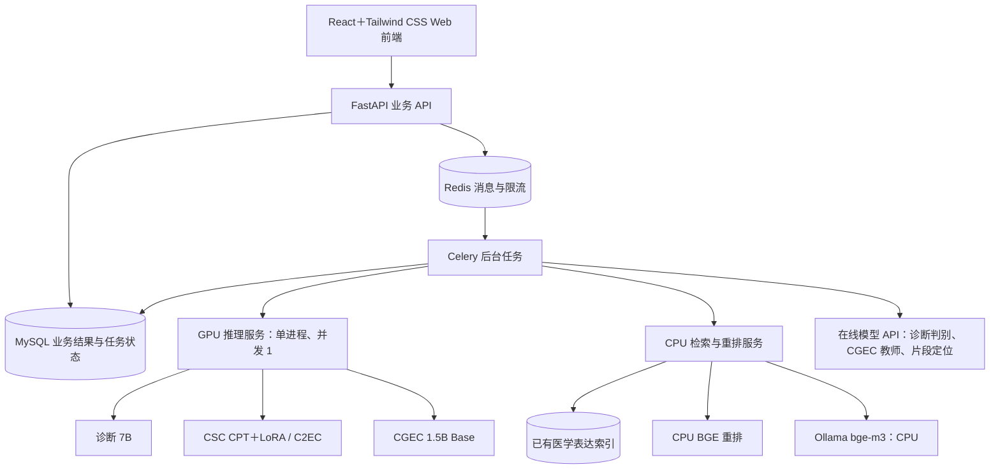

# 医学报告质控后端目录与架构

日期：2026-10-15。状态：用户已认可目录与运行架构，并授权创建项目；所列目录已创建，文件清单仍为后续实施设计，尚未编写业务代码。

主 spec：`2026-10-15-medical-report-qc-rebuild-design.md`；CGEC 方法：`2026-10-15-medical-cgec-experiment-contract.md`。本文件是本轮对后端边界的具体化，不改变两份文档的四分支方法和结果契约。

## 1. 当前范围

用户已取消现有三专家模型方案。新系统只接诊断论文链路：指定本地 7B 生成参考诊断，在线模型根据描述、医生诊断、参考诊断做判别。新目录不包含旧三专家配置、服务依赖或 report/verify/post_verify 兼容代码。

诊断 7B、CSC CPT＋LoRA、CGEC 1.5B Base 是三套不同用途的常驻骨干，不是旧三专家模型。取消旧方案不删除任何当前需要的权重；历史文件的实际磁盘清理不在本次设计修改中执行。

设计者建议：业务采用模块化单体，部署时分离 API、后台任务、GPU 推理、CPU 检索/重排。一个后端仓库维护共享契约，四项检查不拆成四套业务服务。

日志规范（2026-10-15用户指定）：遵循[通用项目日志规范](../../通用项目日志规范.md)与[本项目落地约定](../../日志落地约定.md)。使用Loguru，统一入口 `backend/app/core/logging_config.py`；stdout INFO起、文件DEBUG起，中文动作/key=value字段，Asia/Shanghai每日00:00轮转、保留30天并ZIP压缩（替换旧计划14天）。API/任务/模型/检索的上下文隔离、稳定task_id、request_id传播、最终责任边界单次异常堆栈、多进程文件隔离、脱敏及1000字符外部错误上限均须验收。日志记录真实状态与耗时，不能替代MySQL结果/审计，也不能因HTTP200掩盖status=error。原文中的recognition/csrcqsf仅为来源示例，实际项目路径以上述落地约定为准。

## 2. 拟议目录

位置：`/mnt/mydrive/project/medical-report-qc/backend/`。

```text
backend/
├── pyproject.toml                 # 分组依赖：业务、GPU、检索、开发
├── .env.example                  # 仅变量名和无密钥示例
├── README.md                     # 环境、启动与排障
├── app/                          # 业务 API 和任务进程共用
│   ├── main.py                   # FastAPI 业务入口
│   ├── core/                     # 配置、结构化日志、错误码
│   ├── api/
│   │   ├── router.py
│   │   └── v1/
│   │       ├── reports.py        # 单条输入、批量导入及原文查询
│   │       ├── runs.py           # 创建、启动、进度、取消、失败重试
│   │       ├── results.py        # 四分支结果、证据及阶段记录
│   │       ├── reviews.py        # 人工接受、驳回、编辑后确认
│   │       ├── exports.py        # 导出任务和下载
│   │       └── system.py         # 服务状态、运行配置及预检
│   ├── schemas/                  # 面向 Web 的请求/响应模型
│   ├── domain/                   # 纯业务状态、结论、编辑区间与不变量
│   ├── services/
│   │   ├── report_service.py     # 解析导入、保留行号和原始字段
│   │   ├── run_service.py        # 固定配置、建立四分支工作单元
│   │   ├── execution_service.py  # 认领、心跳、尝试记录、保存结果
│   │   ├── evidence_service.py   # 同次运行检索复用及证据持久化
│   │   ├── review_service.py
│   │   └── export_service.py
│   ├── pipelines/                # 与论文章节对应的四项业务流程
│   │   ├── diagnosis.py          # 7B 参考诊断 → 在线判别
│   │   ├── csc.py                # 128 字工程分块 → C2EC → 原位重组
│   │   ├── cgec.py               # RAG 教师 → 1.5B Reference-only
│   │   └── localization.py       # RAG 定位 → 无错才条件复核
│   ├── ports/                    # 流程依赖的 GPU、检索、在线模型协议
│   ├── clients/                  # 协议的 HTTP 实现、错误映射和超时
│   ├── tasks/
│   │   ├── celery_app.py
│   │   ├── qc_tasks.py           # 每报告、每分支派发
│   │   ├── export_tasks.py
│   │   └── recovery.py           # 补发消息、回收过期租约
│   └── db/
│       ├── session.py
│       ├── models.py             # SQLAlchemy 业务表，不放模型权重
│       └── repositories/        # 事务、原子认领、查询和唯一约束
├── contracts/                    # 三类进程共用的内部 DTO，仅轻量依赖
│   ├── inference.py              # GPU 请求/响应、配置指纹、停止原因
│   ├── retrieval.py              # 全候选、排序、可用性与过滤理由
│   └── errors.py
├── model_runtime/                # 唯一可以初始化 CUDA 的包
│   ├── main.py                   # 内部 GPU HTTP 服务入口，单进程
│   ├── registry.py               # 加载三套骨干，启动时固定身份
│   ├── scheduler.py              # 全局串行队列、期限、幂等请求
│   ├── diagnosis.py              # 指定 7B 的 tokenizer 和生成调用
│   ├── csc.py                    # CPT 共享骨干与 LoRA 分支、C2EC
│   └── cgec.py                   # Base completion 与输出清理
├── retrieval_runtime/            # CPU 索引、召回、重排服务
│   ├── main.py
│   ├── index.py                  # 恢复已有节点、关键词和向量索引
│   ├── embedding.py              # 调用 CPU bge-m3，固定身份
│   ├── reranker.py               # 显式 CPU FP32 BGE
│   └── filtering.py              # 与实验一致的归一化/相似度
├── research_adapters/            # 固定研究源码版本的薄包装
│   ├── simple_csc.py
│   ├── llm4cgec.py
│   └── rag_optimizer.py
├── prompts/                      # 诊断、CGEC、定位的版本化提示资源
├── configs/                      # 模型路径、解码、检索与调度默认值
├── migrations/                   # Alembic 数据库迁移
├── tests/
│   ├── unit/                     # 状态、提示、编辑和过滤等规则
│   ├── integration/              # 数据库、队列、客户端与故障恢复
│   └── smoke/                    # 合成报告的真实模型联调
└── ops/
    ├── scripts/                  # 预检、启动、恢复和诊断入口
    └── systemd/                  # 独立进程的服务/恢复定时器配置
```

模型留在 `/mnt/mydrive/LLM/models/` 与 `/mnt/mydrive/LLM/paper_models/`，索引留在已有缓存位置；路径通过配置加载。权重、运行日志、上传文件和导出文件不进入代码目录。运行文件根目录由配置指定，默认使用新项目的 `var/`，并分 `uploads / exports / audit / logs`。

API/worker 使用业务依赖组与一个环境，GPU 和检索各用独立兼容环境。依赖分组不能导致 API 安装全部 CUDA 或 FlagEmbedding 依赖；开发测试也不能在导入模块时加载模型。

## 3. 进程与依赖



| 进程 | 默认资源/并发 | 负责内容 |
| --- | --- | --- |
| 业务 API | CPU，初版 1 worker | 参数校验、业务写入、状态查询、复核；请求不等待整份报告推理 |
| Celery worker | CPU，单实例 threads pool、并发 4 | 持久化工作单元执行，调用三类服务；每工作单元独立数据库会话 |
| GPU runtime | GPU，1 worker、全局推理并发 1、不开 reload | 常驻诊断 7B、共享 CPT/CSC LoRA、CGEC Base；不访问业务数据库 |
| Retrieval runtime | CPU，1 worker、重排并发 1 | 一份索引、一份 FP32 reranker；初始重排 batch=4、计算线程=4 |
| Ollama embedding | CPU，`num_gpu=0`、初始线程=2 | 沿用现有 bge-m3 向量，不重新生成全库向量 |

MySQL 与 Redis 为基础服务。在线请求通过 Redis 实现跨任务全局最多 2 个并发，并服从各供应商限流；不能让每个 worker 各开 2 个而突破总限额。

三类内部服务仅监听本机并校验内部请求，Web 只调用业务 API。首版 Web 免登录的边界不代表内部推理端口直接供浏览器访问。在线凭据只由 worker 的后端配置读取，配置接口不回显。

调度数值是设计者提出的初始配置，可依据联调调整；GPU 同进程常驻与串行原则为本机容量证据的前提。

## 4. 分层边界

- `api` 只处理 HTTP 和轻量校验，业务交给 `services`，不直接写提示或加载权重。
- `services` 持有业务事务和结果保存，调用 `pipelines`；数据库事务不能跨整段模型网络请求持有。
- `pipelines` 组织方法顺序，通过 `ports` 调模型与检索，只返回结构化分支结果，不绑定 FastAPI、Celery 或 SQLAlchemy。
- `clients` 实现内部/在线 HTTP 调用，返回统一的响应和错误。结构语义校验属于对应流程；有限重试统一由执行层管理，避免 SDK、HTTP、任务层各重试三次形成九次或更多调用。
- `model_runtime` 负责纯推理；CSC adapter 只在其 CPT 骨干中切换，并保留纯语言/提示分支独立 KV。全局 GPU 队列覆盖所有模型角色。
- `retrieval_runtime` 负责一份常驻索引及重排，返回全部候选，不持有业务结果。业务侧保存证据并分别选 Top-5/Top-10；候选共享需要完整指纹一致。
- `research_adapters` 只提取单条、无 gold 的研究方法。业务代码不得运行离线 main、五组消融或 SEE 评测来处理一条报告。
- `contracts` 为独立轻量包；API/worker 导入它不应连带导入研究框架、Torch、CUDA 或索引。提示、配置、研究源码版本和模型身份写入每次运行快照。

统一内部 HTTP 是本轮设计选择；不同时引入 gRPC、消息式 GPU 服务及 subprocess 多套推理协议。四套流程仍可分别更换适配器，但不重复实现业务存储与任务管理。

## 5. 四项流程的模块责任

| pipeline | 输入 | 内部调用顺序 | 主要输出 |
| --- | --- | --- | --- |
| `diagnosis.py` | 原描述＋医生原诊断 | GPU 7B 生成 → 在线判别 | 参考诊断、医生诊断中的可疑片段与原因 |
| `csc.py` | 原描述 | 源文标点分块 ≤128 字 → 各块 GPU C2EC → 原位重组 | 字符纠错建议、原文编辑区间、分块覆盖与失败 |
| `cgec.py` | 原描述 | 召回/CPU 重排 → Top-5 → 在线教师 → GPU 1.5B Reference-only | 教师意见、学生完整建议、差异及分歧 |
| `localization.py` | 原描述 | 召回/CPU 重排 → Top-10 → 在线定位 → 无错才在线复核 | 原文可疑片段、解释、证据和复核记录 |

四项读取相同不可变报告，互不自动接收其他分支的修正。CSC 的 128 字分块是待验收的工程适配，不作为已证实历史实验参数；CGEC 不分 128 字块。共享的是检索结果与资源调度，不是质控结论。

GPU 接口按模型能力提供 `/internal/v1/diagnosis/generate`、`/internal/v1/csc/correct`、`/internal/v1/cgec/correct`；不接受客户端任意指定磁盘模型路径。CPU 服务提供 `/internal/v1/retrieve`、`/internal/v1/rerank`，以及独立的存活/就绪检查。每个推理请求包含 request ID、deadline、配置指纹，响应包含实际角色身份、token/字符覆盖、停止原因及耗时。

GPU HTTP 超时不表示底层推理已经终止；同一 request ID 的重试应查询/复用运行中的请求或已完成短期结果，不能重复排队。超过等待期限、队列已满或进程重启时返回明确状态，业务只重试未确认成功的单元，并记录远端状态未知时可能重复推理的限制。

## 6. 业务数据与恢复

主要表：`reports`、`quality_runs`、`run_reports`、`module_results`、`inference_attempts`、`evidence`、`review_decisions`、`artifacts`、`task_outbox`。CSC 分块执行进度可用关联子记录保存，结构留给实施者，必须支持成功块复用和失败块重试。

- MySQL 保存任务与最终事实。Redis 保存 Celery 消息、短期缓存、全局限流/锁；不能只在 Redis 存唯一一份结果。
- 创建运行、建立工作单元、写 `task_outbox` 在同一事务提交；提交后立即尝试发布。发布失败由恢复流程补发，避免“数据库已有任务但没有入队”。重复消息通过工作单元唯一约束和原子认领消除重复提交。
- worker 先持久化执行租约与 attempt，再调用模型，再独立事务保存有效结果。每工作单元使用线程隔离数据库会话，外部请求期间不长时间占用行锁。
- 服务启动及 `systemd timer` 每分钟执行一次短恢复命令，补发 outbox、回收过期租约、核对孤儿任务。首版不为恢复额外部署 Celery Beat；恢复命令可重入。
- 取消只停止新的工作单元及尚未执行的 CSC 分块，不杀共享模型进程；在途调用安全结束后保留其输出，未执行部分显示取消。
- 任一行、任一分支失败不停止其他任务。失败、取消与未检查均不能记为“无异常”。API 查询与 XLSX 导出都基于已持久化结果。

## 7. 面向前端的接口分组

统一前缀 `/api/v1`，异步处理返回运行或导出 ID。以下是资源边界，字段和分页细节由实施计划展开：

| 资源 | 操作 |
| --- | --- |
| `/reports` | 新增单条、读取不可变原文 |
| `/imports` | 上传 CSV/XLSX、解析进度、列映射确认；在后台分批导入 |
| `/runs` | 单条或已导入报告创建运行、列表与详情 |
| `/runs/{id}/start` | 幂等启动，返回 202 |
| `/runs/{id}/cancel`、`/runs/{id}/retry-failed` | 取消未开始单元、只重试失败分支 |
| `/runs/{id}/reports` | 报告列表、四项状态与完整性 |
| `/results/{id}` | 分支详情、证据、阶段尝试及受控原始响应 |
| `/reviews` | 接受、驳回、自定义修改或暂缓；追加复核记录 |
| `/exports` | 后台生成 XLSX，查询状态、下载已完成文件 |
| `/system/status`、`/system/config`、`/system/preflight` | 状态、非敏感配置与运行前检查 |

上传、导入解析、推理、导出都不以同步长请求阻塞浏览器。原始文件和已解析报告固定后才能启动，个别无效行保留原因。结果详情默认给必要信息，大型原始响应按需获取。

### 7.1 统一响应和异常处理（2026-10-15用户修订）

自有业务与内部模型/检索JSON接口，凡应用可捕获的错误统一HTTP 200，返回 `{"status":"error","data":null,"detail":{...},"request_id":"..."}`。detail提供稳定业务错误code、详细message、失败stage、retryable、异常类型exception_type、脱敏cause、remote_state和定位context；不能仅以HTTP 200判成功。包括参数验证、资源不存在、版本冲突、预检不通过和未知异常，均不得遗漏为框架默认4xx/5xx。第三方供应商仍按其真实HTTP状态分类，再转换本系统错误对象。

JSON成功响应统一 `{"status":"success","data":业务DTO,"detail":null,"request_id":"..."}`；成功原有200/201/202语义保留，任务执行状态在data.status。查询到failed任务是接口查询成功；不能把外层status与任务状态混用。下载成功是实际XLSX二进制200，下载失败是JSON 200/error，前端必须识别而不是保存成xlsx。

异常在能处理的边界捕获：适配器转换已知异常并用 `raise ... from exc` 保留原因；阶段执行器保存失败attempt、按原预算有限重试，耗尽后抛出；工作单元边界记录failed并继续其他工作。持久化失败本身无法记录时回滚并重新抛出交恢复机制，不能吞异常假确认。统一HTTP处理器负责将异常转换为响应，并保存可用request_id关联的脱敏堆栈与cause链。普通捕获不截获退出/协程取消控制信号，后台Future异常必须读取/记录。

前端与内部HTTP客户端先验证status，error时读取detail并抛typed异常；页面展示详细原因、阶段及追踪编号。维护日志保留格式化脱敏traceback，detail不包含凭据、原始SQL或患者正文。健康探测也要读status/data.ready，CLI/任务失败继续非零退出/抛出，不能因为HTTP统一200而丢失失败语义。具体类型、错误码及测试归属见实施总计划“统一响应与异常维护约定”。

## 8. 审核边界

本轮请审核目录职责、四进程拆分、四条 pipeline 的调用方向和数据保存方式。技术默认选择仍可调整，具体数据库字段、端口、连接池、租约长度等由实施计划确定。

用户审核认可后，本轮已创建项目及 backend 各级目录、迁移三份 spec；树中具体业务文件尚未创建，未卸载旧服务或删除旧权重。后续按完整 spec 编写实施计划。

2026-10-15 本架构与主 spec、CGEC 方法附录共同完成独立 builder check，结论为 `nothing important left`；该结果只表示可以据此制定实施计划，不替代用户对目录与架构的审核。
